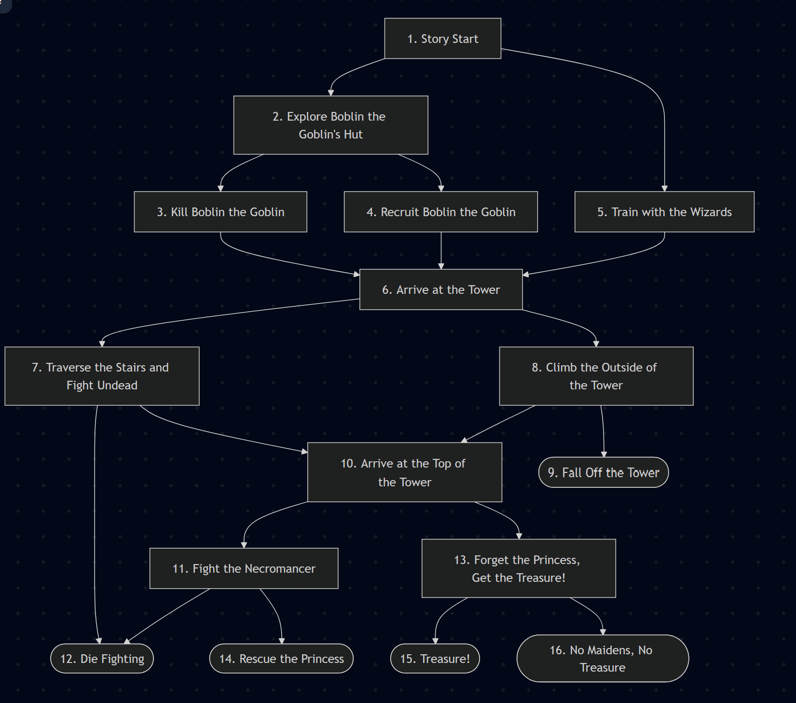

# Group2-Final-Project
This is where all official documentation and code for the final project is kept
## L. Hickman TO-DO
 - [x] Create Story Flowchart
 - [ ] Create full story text
 - [ ] Story Module

## A. Negi TO-DO
 - Currently has no explicit responsibilities
 - Primarily will focus on HTML/CSS

## K. Solloway TO-DO
 - Currently has no explicit responsibilities

## Story
flowchart in text:
  
flowchart TD  
    N1["1. Story Start"]  
    N2["2. Explore Boblin the Goblin's Hut"]  
    N3["3. Kill Boblin the Goblin"]  
    N4["4. Recruit Boblin the Goblin"]  
    N5["5. Train with the Wizards"]  
    N6["6. Arrive at the Tower"]  
    N7["7. Traverse the Stairs and Fight Undead"]  
    N8["8. Climb the Outside of the Tower"]  
    N9(["9. Fall Off the Tower"])  
    N10["10. Arrive at the Top of the Tower"]  
    N11["11. Fight the Necromancer"]  
    N12(["12. Die Fighting"])  
    N13["13. Forget the Princess, Get the Treasure!"]  
    N14(["14. Rescue the Princess"])  
    N15(["15. Treasure!"])  
    N16(["16. No Maidens, No Treasure"])  

    N1 --> N2
    N1 --> N5

    N2 --> N3
    N2 --> N4

    N3 --> N6
    N4 --> N6
    N5 --> N6

    N6 --> N7
    N6 --> N8

    N7 --> N12
    N7 --> N10

    N8 --> N10
    N8 --> N9

    N10 --> N11
    N10 --> N13

    N11 --> N12
    N11 --> N14

    N13 --> N15
    N13 --> N16
Flowchart in Image:  

## GDD
### HTML:
The HTML document needs to have four major elements to it:
1. The title of the story
2. The current node of the story and image content
3. The inventory display
4. The buttons

### CSS:
The CSS document has no real restrictions beyond making the HTML look good. WE CAN USE AI FOR THIS DOCUMENT ONLY.

### JavaScript:
There are few general requirements:
Use document.getElementByIdI() to integrate HTML and JS features
Use multiple separate functions (this is covered implicitly by separating things into modules, but within each module there are probably multiple functions)
CREATE DOM ELEMENTS (not everything we need can be created in the HTML file beforehand)
Use at least 3 objects using the class structure
Implement error handling with try-catch blocks
Update paragraph’s textContent

Things that we don’t need to worry about because they are necessary to get anything to work:
Use conditional logic, loops, and event-listeners

Not required by the assignment, but something I would like for us to follow:
To make data accessing and outputting modular, use external files (likely JSON) to store the data and use a loop to populate an array with instances of the objects, dictionaries, etc. This will save a ton of time when it comes to coding. I can give examples and help you out with anything if you are struggling with this.

Modules:
Story:(probably the most complex)
Responsible for managing all story elements and adding the necessary images and text to the HTML.
This would store: all relevant HTML (as individual variables), story objects (stored in an array) that contain story text (as an array of strings to allow for longer sections to split into multiple pages. Updates a bool on if the end of the array has been reached), references to images, and pointers to what story objects can follow the current story object, as well as all of the event flags (in a dictionary where the key is the flag name and the value is the Boolean flag). This module would also likely need to manage displaying the future options for the story. 
This module will need to include a function that gets called which manages special story events (basically, it would handle calling the QTE, delayed effects, and user input functions)
For simplicity’s sake, I think the delayed event and play a sound requirement belong in this module, that way everything related to those events can be ironed out here

#### Saving/Loading: (light)
This section would be responsible for creating the cookie, formatted using JSON, that would store everything necessary to resume the story in the same place as well as tracking ending completion. This module would also handle loading from the cookie.

#### Log: (medium)
A few lines of code that would output whatever is necessary to allow a player to see a history of their game, and handle displaying the log. Optionally can include -- not displaying the log at all times and/or providing a downloadable log file for a user after each run

#### Items: (light)
Responsible for managing an array that represents an inventory in code, and handles displaying images for each item on the document. Ideally, each item would be a class object with methods for returning the important variables (like name, item type, etc.)

#### QTE (Quick Time Event): (medium)
Responsible for the logic of the mandatory quick time event. TL;DR, must use setInterval to force the player to make a decision, or else face a consequence. Logically would also need some sort of visual representation of the time ticking down (easiest would be a numbered timer counter down, fancy would be to make a circle that changes color in proportion to the remaining time). The QTE in the story would be repeated, so make sure this function can be repeated without error.

#### Loading bar: (super light)
Tracks the number of story events completed and uses  to display a progress bar of how many story nodes have been completed.

#### User Input: (medium)
Creates an input box and validates a user’s input. This would, again, be used repeatedly within a single node, so ensure that that answers can be stored in a semi-permanent way.

#### Reset: (WAIT TO END!!! light)
Handles resetting the story, items, and all event flags to their default values (this can be used to reset the stored inputs from the User Input module)

#### Keyboard Listener: (light)
Manages logic for listening to key strokes. Specifically, listens for either ‘1’ or ‘2’ when a story choice needs to be made, and both ‘enter’ and ‘space’ for advancing the story when no choice needs to be made. The way this would be checked is with a global Boolean that gets updated in the story module. If you are responsible for this, just check the Boolean and continue on. Whoever is handling the Story module will ensure the Boolean is correct.

#### Hover: (medium)
Responsible for the mouseover and mouseout listener functions so that mousing over things will enlarge them while hovered. You just need one function that will be called by every element that can be hovered.

#### Achievement Tracker: (medium)
The achievement tracker would be an object that stored what endings a user has gotten (as a dictionary of Boolean event flags), as well as having methods that are responsible for displaying achievement history and returning the event flags for saving purposes.

